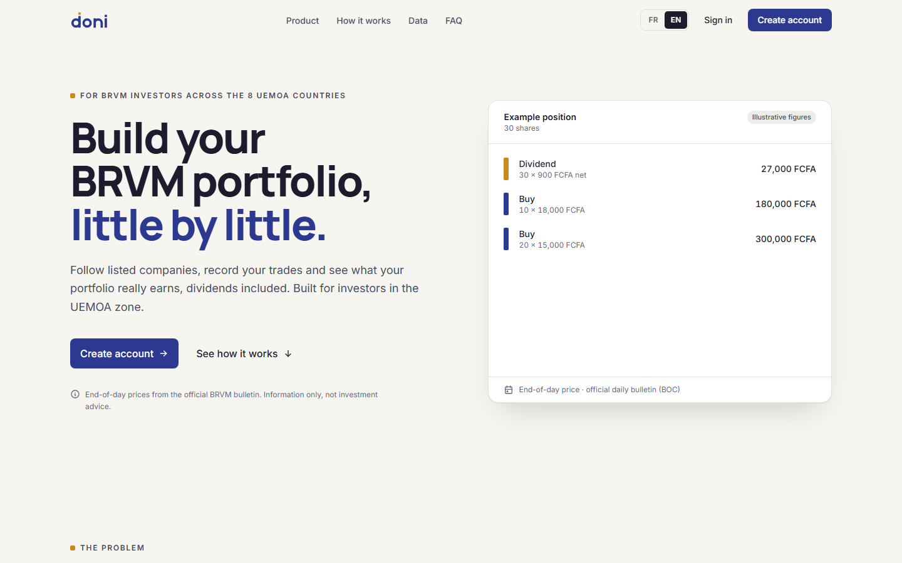
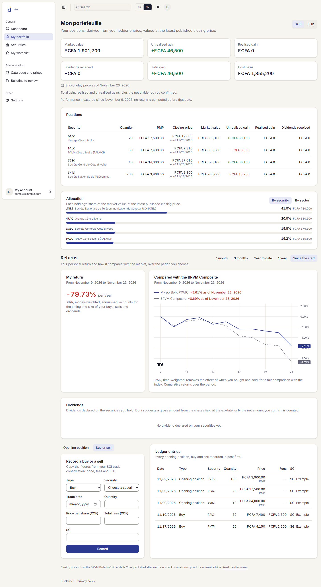
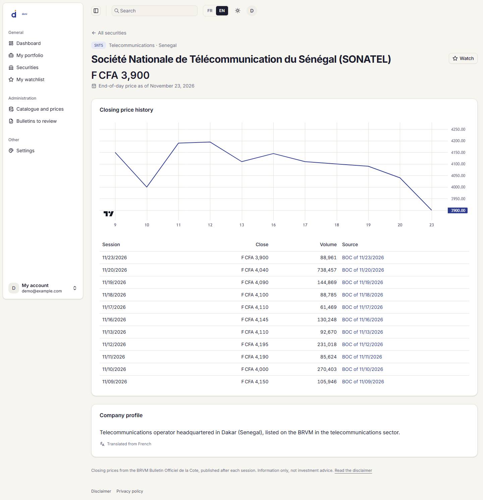
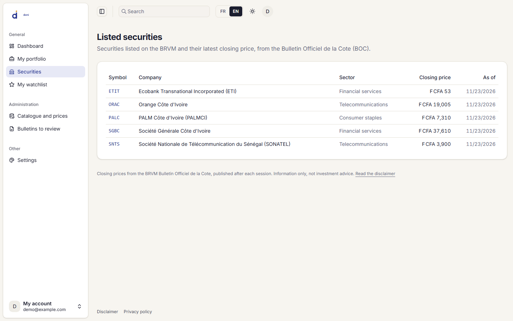
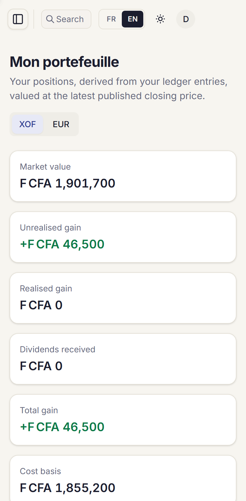
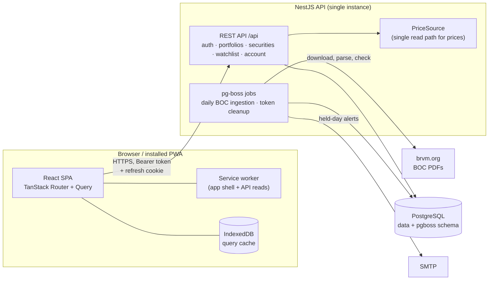

<div align="center">
  

  <p><strong>BRVM research and portfolio tracking for investors in the UEMOA zone.</strong></p>

  <p>
    <a href="https://github.com/Yobson2/Doni/actions/workflows/ci.yml"></a>
    
    
    
    
    
  </p>
</div>

---

**Doni** is an installable web app (PWA) for people who already hold shares listed on the **BRVM** (Bourse Régionale des Valeurs Mobilières), the stock exchange shared by the eight UEMOA countries of West Africa. It reads the exchange's official daily bulletin (the BOC), keeps end-of-day prices, and shows each user what their holdings are worth and how they have actually performed, dividends and corporate actions included.

Today, BRVM investors track their positions from paper or PDF statements sent by their broker (SGI) and from daily PDF bulletins. Doni turns those into a portfolio that values itself every evening.

> [!NOTE]
> Doni provides **information only, never investment advice** ([ADR 0002](docs/adr/0002-information-only-regulatory-stance.md)). It is in a **free beta**; see [Project status](#project-status).

<p align="center">
  
</p>

## Contents

- [Features](#features)
- [Screenshots](#screenshots)
- [Tech stack](#tech-stack)
- [Architecture](#architecture)
- [Project structure](#project-structure)
- [Getting started](#getting-started)
- [Environment variables](#environment-variables)
- [Scripts](#scripts)
- [Testing](#testing)
- [API](#api)
- [Authentication](#authentication)
- [Deployment](#deployment)
- [Project status](#project-status)
- [Documentation](#documentation)
- [License](#license)

## Features

**For investors**

- **Portfolio from a ledger.** Record buys and sells (with fees and SGI), or an *opening position* (quantity and average cost on a date) instead of years of past trades. Positions, average cost (PMP), realised and unrealised gains are derived by replaying an append-only ledger.
- **Backdated corrections.** Edit or delete any entry, however old; the portfolio is recomputed and a correction that would oversell at any date is refused.
- **Returns that mean something.** *Mon rendement* (XIRR, money-weighted and annualised) and a time-weighted return (TWR) charted against the **BRVM Composite** index over 1M / 3M / YTD / 1Y / all time.
- **Dividends.** Declared dividends produce suggestions (shares held at the ex-date × gross amount); only the net amount the user confirms enters the ledger.
- **Corporate actions.** Splits, reverse splits, free-share allotments and rights issues restate quantities and price history.
- **Allocation** by security and by sector, and amounts in **XOF or EUR** (display only, at the fixed 655.957 peg).
- **Securities catalogue and company pages** with closing-price history, each price linked to the bulletin it came from.
- **Watchlist**, **account data export (JSON)** and **account deletion**.
- **Public guides, an SGI directory and legal pages**, in **French (default) and English**.
- **Installable PWA with a read-only offline mode**: the last synced portfolio and prices stay readable without a connection.

**Market data pipeline (admin)**

- **Daily BOC ingestion** every trading-day evening: downloads the bulletin PDF from brvm.org, keeps the original with its SHA-256, parses it and runs automatic checks (right day, every security present, BRVM daily variation limit, index and volume consistency).
- A day that fails a check is **held for review** and never shown to users; admins are emailed the reasons, inspect the parsed rows next to the original PDF, correct misread values and publish.
- **Historical backfill** of 2016–2025 bulletins (four layouts), through the same checks, kept hidden behind a licence-gate flag until redistribution terms allow it ([ADR 0018](docs/adr/0018-historical-backfill-behind-licence-gate.md)).
- Catalogue administration: securities, sectors, indices, manual price entry, corporate actions and declared dividends.

## Screenshots

Captured from a local run with real BOC prices (November 2026) and a demo portfolio.

| Portfolio | Company page |
| --- | --- |
|  |  |
| Totals, positions with PMP and gains, allocation, XIRR and TWR vs. the BRVM Composite, entry forms and the ledger. | Closing-price history, with each session linked to the bulletin it was read from. |

| Securities | Mobile (PWA) |
| --- | --- |
|  |  |
| Every price is shown with the date it applies to ("as of"). | Mobile-first layout; installable, with a read-only offline mode. |

## Tech stack

| Layer | Technologies |
| --- | --- |
| **Frontend** | React 19, TypeScript, Vite 6, TanStack Router (file-based) and TanStack Query, Tailwind CSS 4, shadcn/ui on Radix UI, React Hook Form + Zod, i18next (FR/EN), lightweight-charts, Framer Motion |
| **API client** | `openapi-typescript` types generated from the backend's OpenAPI spec, `openapi-fetch` |
| **PWA / offline** | `vite-plugin-pwa` (Workbox), TanStack Query cache persisted to IndexedDB (`idb-keyval`) |
| **Backend** | NestJS 11, TypeORM, PostgreSQL 16, pg-boss (scheduled jobs, stored in Postgres), JWT + rotating refresh cookie, bcrypt, Helmet, `@nestjs/throttler`, Swagger |
| **Domain maths** | `big.js` decimal arithmetic (money stored as Postgres `numeric`, never floats) |
| **Market data** | `pdfjs-dist` text extraction and layout-specific BOC parsers |
| **Email** | Nodemailer + Handlebars templates (Mailpit locally) |
| **Testing** | Jest + Supertest + fast-check (backend), Vitest + Testing Library (frontend), Playwright (offline browser test), Lighthouse CI (installability) |
| **Tooling / CI** | pnpm workspace, ESLint, Prettier, knip, GitHub Actions |

## Architecture



- **One backend, one database.** Postgres is the only infrastructure dependency: it also holds the job queue (pg-boss) ([ADR 0009](docs/adr/0009-postgres-only-infrastructure-pg-boss.md)).
- **Append-only ledger.** Ledger entries are never updated; a correction voids an entry and records its replacement. Positions are always derived by replay ([ADR 0004](docs/adr/0004-append-only-ledger.md)).
- **One way in for prices.** Everything that reads prices goes through `PriceSource`, which only serves published days, and serves backfilled history only when the licence gate is open ([ADR 0003](docs/adr/0003-boc-first-data-with-licence-gate.md)).
- **Typed contract.** The backend emits `openapi.json`; the frontend generates its client types from it, and an e2e test fails if the committed spec is stale.

More detail in **[docs/ARCHITECTURE.md](docs/ARCHITECTURE.md)**.

## Project structure

```text
Doni/
├── doni-backend/              # NestJS API
│   ├── src/
│   │   ├── common/            # config, database + migrations, jobs, mail, guards, filters
│   │   └── modules/
│   │       ├── auth/          # sign-up, sign-in, refresh, sign-out
│   │       ├── users/         # own profile, account administration
│   │       ├── account/       # data export and deletion
│   │       ├── securities/    # catalogue, prices, PriceSource, BOC ingestion,
│   │       │                  # corporate actions, reference dividends
│   │       ├── ledger/        # portfolios, ledger engine, returns, dividends
│   │       ├── watchlist/
│   │       └── health/
│   ├── scripts/               # seed-catalogue, backfill-boc, emit-openapi
│   ├── templates/             # Handlebars email templates
│   ├── test/                  # e2e suites (real Postgres) and BOC PDF fixtures
│   └── openapi.json           # committed API contract
├── doni-frontend/             # React PWA
│   ├── src/
│   │   ├── routes/            # file-based routes: _public, (auth), _authenticated
│   │   ├── features/          # portfolio, securities, watchlist, bulletins, settings, content…
│   │   ├── content/           # bundled Markdown guides, legal pages, SGI directory
│   │   ├── lib/offline/       # service worker registration, cache persistence
│   │   ├── i18n/              # fr.json (default), en.json
│   │   └── api/               # openapi-fetch client + generated schema.d.ts
│   └── e2e/                   # Playwright offline test and mock API
├── docs/
│   ├── adr/                   # 18 architecture decision records
│   ├── images/                # README screenshots
│   └── …                      # architecture, API, deployment, brand, backfill report
├── CONTEXT.md                 # domain glossary (the project's ubiquitous language)
├── ROADMAP.md
└── .github/workflows/ci.yml
```

## Getting started

### Prerequisites

- **Node.js 20+**
- **pnpm 10** (`corepack enable` picks up the version pinned in `package.json`)
- **Docker** (for PostgreSQL and Mailpit), or your own PostgreSQL 16

### 1. Install

```bash
git clone https://github.com/Yobson2/Doni.git
cd Doni
pnpm install
```

### 2. Start the database and mail catcher

```bash
cd doni-backend
cp .env.example .env
docker compose up -d        # PostgreSQL on :5432, Mailpit on :1025 (UI: http://localhost:8025)
```

Edit `.env` and set **`JWT_ACCESS_SECRET`** and **`JWT_REFRESH_SECRET`** to two different random values (the API refuses to start otherwise):

```bash
node -e "console.log(require('crypto').randomBytes(48).toString('base64url'))"
```

### 3. Create the schema and seed data

```bash
pnpm migration:run          # create the schema (synchronize is off; migrations only)
pnpm seed:catalogue         # 5 securities, 2 indices and real BOC prices for 3 sessions
```

### 4. Run the API and the app

```bash
# terminal 1, in doni-backend/
pnpm start:dev              # API on http://localhost:3000, Swagger UI on /api/docs

# terminal 2, in doni-frontend/
pnpm dev                    # app on http://localhost:5173
```

In development the Vite server proxies `/api` to `http://localhost:3000`, so the session cookie stays same-origin and no frontend `.env` is needed.

### 5. Become an admin (optional)

Sign up in the app, then grant yourself the admin role, which unlocks the catalogue and bulletin-review screens. There is deliberately no API to self-promote:

```bash
docker exec -it app-postgres psql -U postgres -d app_db \
  -c "UPDATE users SET role = 'ADMIN' WHERE email = 'you@example.com';"
```

Sign out and back in to get a token with the new role. With the admin account you can fetch recent bulletins from brvm.org from the *Bulletins to review* screen or with `POST /api/bulletins/:date/ingest`.

## Environment variables

### Backend (`doni-backend/.env`)

See [`doni-backend/.env.example`](doni-backend/.env.example) for the annotated template.

| Variable | Required | Default | Description |
| --- | :---: | --- | --- |
| `NODE_ENV` | | `development` | `development`, `production` or `test` |
| `PORT` | | `3000` | HTTP port |
| `CORS_ORIGINS` | | `http://localhost:3000,http://localhost:4200` | Comma-separated allowed origins (only needed when the frontend is on another origin) |
| `DB_HOST`, `DB_PORT`, `DB_USER`, `DB_PASS`, `DB_NAME` | ✅ | | PostgreSQL connection |
| `DB_SSL_REJECT_UNAUTHORIZED`, `DB_CA_CERT`, `DB_POOL_SIZE` | | | TLS and pool settings for managed databases |
| `JWT_ACCESS_SECRET`, `JWT_REFRESH_SECRET` | ✅ | | Token signing secrets; both required and different |
| `JOBS_POOL_SIZE`, `JOBS_CRON_MONITOR_INTERVAL_SECONDS`, `JOBS_CRON_WORKER_INTERVAL_SECONDS` | | pg-boss defaults | Job runner tuning |
| `BOC_INGESTION_CRON` | | `30 18,21 * * 1-5` | Daily ingestion schedule (Africa/Abidjan); `off` disables it |
| `BOC_LISTING_URL`, `BOC_FILES_URL` | | brvm.org URLs | Where bulletins are fetched from |
| `HISTORY_PUBLIC` | | `false` | Serve backfilled (pre-2026) prices to users; keep off until the licence gate is cleared |
| `MAIL_HOST`, `MAIL_PORT`, `MAIL_USER`, `MAIL_PASS`, `MAIL_FROM` | | Mailpit | SMTP settings |
| `APP_NAME` | | `Our App` | App name used in email templates |
| `RUNNING_IN_DOCKER` | | `false` | When `true`, variables are read from the environment instead of `.env` |

### Frontend (`doni-frontend/.env`, optional)

| Variable | Default | Description |
| --- | --- | --- |
| `VITE_API_URL` | *(empty: same origin)* | API origin for production builds when the API is on another domain, e.g. `https://api.example.com` (build time) |
| `VITE_DEV_API_PROXY` | `http://localhost:3000` | Where `pnpm dev` proxies `/api` (read from the shell environment by `vite.config.ts`) |

## Scripts

Run from the repository root (CI runs the same commands):

| Command | What it does |
| --- | --- |
| `pnpm install` | Install both packages |
| `pnpm lint` | ESLint in both packages |
| `pnpm typecheck` | TypeScript, no emit |
| `pnpm test` | Unit tests (Jest backend, Vitest frontend) |
| `pnpm test:e2e` | Backend end-to-end tests against a real, disposable Postgres |
| `pnpm build` | Build both packages |

Package-specific commands (`pnpm --filter doni-backend <script>` or from the package folder):

| Package | Command | What it does |
| --- | --- | --- |
| backend | `start:dev` / `start:prod` | Run with hot reload / run the compiled build |
| backend | `migration:run` / `migration:revert` / `migration:generate` | Manage the schema |
| backend | `seed:catalogue` | Add the seed securities and their BOC prices (idempotent) |
| backend | `backfill:boc --from YYYY-MM-DD --to YYYY-MM-DD` | Historical BOC backfill ([details](doni-backend/README.md#historical-boc-backfill-adr-0018)) |
| backend | `openapi:emit` | Regenerate `openapi.json` (no database needed) |
| frontend | `dev` / `preview` | Dev server / serve the production build |
| frontend | `api:generate` | Regenerate API types from `doni-backend/openapi.json` |
| frontend | `knip` | Unused files, exports and dependencies |
| frontend | `size` | JavaScript budget: first load under 200 KB gzipped (after `build`) |
| frontend | `test:browser` | Playwright offline test of the built PWA (after `build`) |
| frontend | `lighthouse` | Lighthouse CI installability checks (after `build`) |

## Testing

```bash
pnpm test                    # unit tests, both packages
```

The **backend e2e suite** boots the whole app against a real Postgres. Each spec drops and rebuilds the schema from migrations, so use a throwaway database; the suite never reads `.env`:

```bash
docker run -d --name doni-e2e-pg -p 55432:5432 \
  -e POSTGRES_PASSWORD=postgres -e POSTGRES_DB=doni_test postgres:16
DB_PORT=55432 pnpm test:e2e
```

The **PWA checks** run against a production build with a stubbed API, so they need no backend:

```bash
cd doni-frontend
pnpm build
pnpm exec playwright install chromium   # first time only
pnpm test:browser && pnpm lighthouse && pnpm size
```

The ledger replay engine has property-based tests (fast-check), and the BOC parsers are tested against real bulletins from every supported layout in [`doni-backend/test/fixtures/boc/`](doni-backend/test/fixtures/boc/).

CI ([`.github/workflows/ci.yml`](.github/workflows/ci.yml)) runs three jobs on every pull request: lint, type-check, knip, unit tests, build and the JS budget; the offline browser test and Lighthouse; and the backend e2e suite against Postgres 16.

## API

The REST API lives under `/api` (plus an unauthenticated `GET /health`). With the backend running, interactive Swagger docs are at **http://localhost:3000/api/docs**, and the contract is committed as [`doni-backend/openapi.json`](doni-backend/openapi.json).

| Area | Base path | Access |
| --- | --- | --- |
| Auth | `/api/auth` | Public / refresh cookie |
| Own account and admin user management | `/api/users` | User / admin |
| Catalogue: securities, prices, sectors, indices, corporate actions, declared dividends | `/api/securities`, `/api/sectors`, `/api/indices` | Read: user; write: admin |
| Bulletins (BOC review) | `/api/bulletins` | Admin |
| Portfolios: ledger, valuation, returns, dividends | `/api/portfolios` | Owner |
| Watchlist | `/api/watchlist` | User |
| Data export and account deletion | `/api/account` | User |

The full endpoint reference, error format and rate limits are in **[docs/API.md](docs/API.md)**.

## Authentication

Email and password ([ADR 0011](docs/adr/0011-auth-session-model.md)):

- **Access token**: a 15-minute JWT sent as `Authorization: Bearer`, kept **in memory only** by the frontend.
- **Refresh token**: sent only in an `HttpOnly; Secure; SameSite=Strict` cookie scoped to `/api/auth`, stored hashed and **rotated on every refresh**. Replaying an already-rotated token revokes the whole session.
- **Roles**: every account is a regular user; `ADMIN` unlocks catalogue management and bulletin review.
- Passwords are hashed with bcrypt; requests are rate-limited.

## Deployment

The target setup ([ADR 0013](docs/adr/0013-eu-hosting-with-pitr.md)) is the **frontend on Vercel** (`doni-frontend/vercel.json`), the **backend as one managed container** (`doni-backend/Dockerfile`) and **managed PostgreSQL in an EU region with point-in-time recovery**, with migrations run on each deploy. The production deployment itself is still an open task ([#6](https://github.com/Yobson2/Doni/issues/6)).

Both Dockerfiles build from the repository root:

```bash
docker build -f doni-backend/Dockerfile -t doni-backend .
docker build -f doni-frontend/Dockerfile --build-arg VITE_API_URL=https://api.example.com -t doni-frontend .
```

Step-by-step instructions: **[docs/DEPLOYMENT.md](docs/DEPLOYMENT.md)**.

## Project status

The MVP tracked in [ROADMAP.md](ROADMAP.md) (issues #1–#21) is built except for:

- **Production deployment** ([#6](https://github.com/Yobson2/Doni/issues/6)): not live yet.
- **Daily alerts / push notifications** ([#19](https://github.com/Yobson2/Doni/issues/19)): not built yet.

### Known limitations

- **Password reset is not implemented.** The *Forgot password* screen is a placeholder and there is no reset endpoint (an email template exists but is unused). There is no email verification either.
- **The dashboard is an empty placeholder**; the portfolio page is the main screen.
- **The SGI directory contains placeholder entries**, explicitly marked as not real, until the licensed SGIs and their fee schedules are entered from sourced documents.
- **Historical prices are hidden** (`HISTORY_PUBLIC=false`) until the BRVM's redistribution terms cover them; only a [sample backfill](docs/backfill-report.md) has been run so far.
- **Listed shares only**: no bonds.
- **Offline mode is read-only** by design ([ADR 0010](docs/adr/0010-read-only-offline.md)): recording trades needs a connection.
- **Single backend instance**: rate-limit counters live in process memory ([ADR 0009](docs/adr/0009-postgres-only-infrastructure-pg-boss.md)).
- Admin rights are granted directly in the database.

### Future improvements

From the roadmap, for the public V1: written BRVM redistribution terms (to open historical data) and a monetisation decision ([ADR 0014](docs/adr/0014-free-beta-without-payments.md)). Explicitly deferred: bonds, a screener, technical analysis, AI features, quizzes, a virtual portfolio and CSV import of trades.

## Documentation

| Document | Contents |
| --- | --- |
| [CONTEXT.md](CONTEXT.md) | Domain glossary: BOC, ledger entry, PMP, XIRR/TWR, corporate actions… |
| [docs/ARCHITECTURE.md](docs/ARCHITECTURE.md) | Modules, data flows, key design choices |
| [docs/API.md](docs/API.md) | Endpoint reference, auth, errors, rate limits |
| [docs/DEPLOYMENT.md](docs/DEPLOYMENT.md) | Building and deploying frontend and backend |
| [docs/adr/](docs/adr/) | 18 architecture decision records |
| [ROADMAP.md](ROADMAP.md) | MVP scope, V1 conditions, deferred features |
| [CONTRIBUTING.md](CONTRIBUTING.md) | Workflow, conventions and checks |
| [doni-backend/README.md](doni-backend/README.md) | Backend internals: jobs, BOC ingestion and backfill, migrations |
| [doni-frontend/README.md](doni-frontend/README.md) | Frontend internals: routing, PWA and offline mode, i18n |
| [docs/brand/logo.md](docs/brand/logo.md) | Logo concept and usage rules |

## License

No license has been chosen for this repository yet, so all rights are reserved by default. *(The backend's `package.json` declares MIT, but the repository has no license file to make that effective.)*
