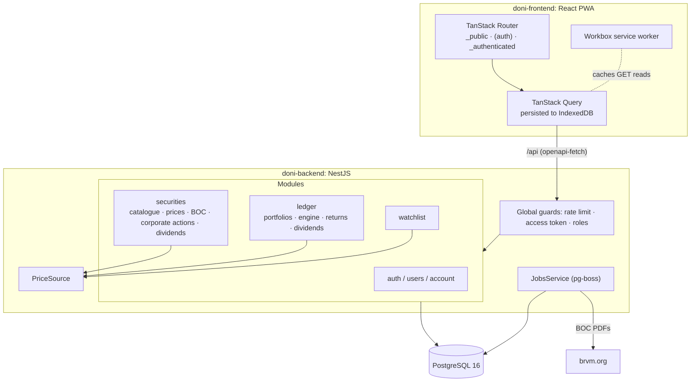
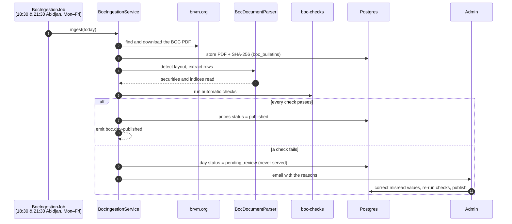

# Architecture

How Doni is put together and why. Terms in **bold** follow the glossary in [`CONTEXT.md`](../CONTEXT.md); the reasoning behind each choice is recorded in the [ADRs](adr/).

## System overview

The repository is a **pnpm workspace** with two packages, `doni-backend` and `doni-frontend`, that share one lockfile and one CI pipeline.

## Backend

NestJS 11 with TypeORM on PostgreSQL. `synchronize` is off everywhere: the schema is owned by migrations in `src/common/database/migrations/`.

### Modules

| Module | Responsibility |
| --- | --- |
| `auth` | Sign-up, sign-in, refresh-token rotation, sign-out; daily cleanup of expired refresh tokens |
| `users` | The signed-in user's profile (name, display currency); account administration for admins |
| `account` | Export all of a user's data as JSON; delete the account and everything it owns ([ADR 0016](adr/0016-account-export-and-deletion.md)) |
| `securities` | Catalogue (securities, sectors, indices), end-of-day prices, `PriceSource`, BOC ingestion, backfill and review, corporate actions, reference dividends |
| `ledger` | Portfolios and their ledger, the replay engine, valuation and allocation, returns (XIRR/TWR), the dividend calendar |
| `watchlist` | Watched securities with their latest price |
| `health` | `GET /health`: database and job runner status |

Shared infrastructure in `src/common/`: environment loading, database config and `BaseEntity`, the pg-boss `JobsService`, the mail service, decorators (`@Public`, `@Roles`, `@GetUserId`), guards, the global exception filter, and a `user-data` registry through which each module declares what it contributes to account export and deletion.

### Request pipeline

Every request passes through Helmet, CORS, cookie parsing and a strict `ValidationPipe` (unknown fields are rejected), then global guards: rate limiting (`AppModule`), and the access-token guard (skipped by `@Public()`) and roles guard (`@Roles(UserRole.ADMIN)`) registered by `AuthModule`. Errors are normalised by `GlobalExceptionFilter` (see [API.md](API.md#errors)).

### The ledger engine

`src/modules/ledger/engine/` is pure TypeScript with no framework or database dependency, which makes it easy to unit- and property-test.

- A portfolio's state is never stored. `replay()` folds the **ledger entries** (buys, sells, **opening positions**, **user dividends**), minus voided ones, in date order and applies **corporate actions** on their effective dates. It yields positions, **PMP** and realised gains at any date ([ADR 0004](adr/0004-append-only-ledger.md), [ADR 0006](adr/0006-pmp-cost-basis.md), [ADR 0015](adr/0015-corporate-actions.md)).
- A **correction** never mutates an entry: it records a void and, for an edit, a replacement. Before accepting it, the service replays the resulting ledger and refuses it if any date would hold a negative quantity.
- All money uses `big.js` and is stored as Postgres `numeric`, in XOF. EUR is a display conversion at the fixed peg (655.957) ([ADR 0005](adr/0005-numeric-money-and-decimal-library.md), [ADR 0008](adr/0008-xof-stored-fixed-peg-eur-display.md)).
- Returns ([ADR 0007](adr/0007-xirr-and-twr-returns.md)): **XIRR** (`xirr.ts`) from the user's dated cash flows, and **TWR** (`twr.ts`), sub-period returns between valued days linked by multiplication, compared with the BRVM Composite (`BRVM-C`). Days with missing data get no point and are reported as gaps.
- **Dividend suggestions** are derived on every read from reference dividends and the shares held at the ex-date; only confirmed net amounts are written to the ledger ([ADR 0017](adr/0017-dividend-suggestions-derived-on-read.md)).

### Market data: from BOC to price

- **Idempotent.** Re-running a day with the same PDF changes nothing; a new PDF replaces a held day; a published day is never overwritten by ingestion.
- **Layouts.** `boc-layout.ts` identifies the layout from what the bulletin prints, never from its date: `boc-parser.ts` reads the 2026 layout and `boc-legacy-parser.ts` the 2016–2025 layouts. An unknown layout holds the day.
- **Backfill.** `pnpm backfill:boc` walks past weekdays through the same service and checks, marks bulletins `origin = 'backfill'`, and writes a report ([ADR 0018](adr/0018-historical-backfill-behind-licence-gate.md), [sample report](backfill-report.md)).
- **One read path.** `DatabasePriceSource` (behind the `PriceSource` interface) is the only way the rest of the app reads prices. It serves only published days, and serves backfilled days only when `HISTORY_PUBLIC=true`. Valuation, returns, the catalogue and the watchlist therefore all follow the licence gate without code of their own ([ADR 0003](adr/0003-boc-first-data-with-licence-gate.md)).

### Jobs

pg-boss keeps its queue in the `pgboss` schema of the same database and creates or upgrades it on start-up ([ADR 0009](adr/0009-postgres-only-infrastructure-pg-boss.md)). Scheduled jobs: daily BOC ingestion, refresh-token cleanup and a heartbeat that the health check reports.

### Data model

| Area | Tables |
| --- | --- |
| Accounts | `users`, `refresh_tokens` |
| Catalogue and market data | `sectors`, `securities`, `market_indices`, `eod_prices` (security or index), `boc_bulletins` (original PDF, checksum, status, check failures, origin) |
| Issuer events | `corporate_actions`, `reference_dividends` |
| Portfolios | `portfolios`, `ledger_entries`, `ledger_entry_voids`, `dividend_dismissals` |
| Watchlist | `watchlist_items` |

## Frontend

React 19 + Vite, written as a mobile-first installable PWA.

| Concern | Implementation |
| --- | --- |
| Routing | TanStack Router, file-based (`src/routes/`): `_public` (landing, guides, SGI directory, legal), `(auth)` (sign-in, sign-up), `_authenticated` (portfolio, securities, watchlist, settings, `admin/*`) |
| Server state | TanStack Query; the API client is `openapi-fetch` typed by `src/api/schema.d.ts`, generated from `doni-backend/openapi.json` |
| Session | Access token in memory (Zustand store); on reload the app calls `/api/auth/refresh`, which uses the `HttpOnly` cookie |
| UI | Tailwind CSS 4, shadcn/ui on Radix, `lightweight-charts` for price and return charts |
| i18n | i18next with `fr.json` (default) and `en.json`; an ESLint rule rejects hard-coded UI strings ([ADR 0012](adr/0012-french-and-english-french-default.md)) |
| Content | Guides and legal pages are Markdown bundled into route chunks (`src/content/`), so they work offline |

### Offline mode ([ADR 0010](adr/0010-read-only-offline.md))

- The Workbox service worker precaches the app shell and every JS/CSS chunk, and caches GET reads of portfolios, securities, sectors, watchlist and `users/me` network-first. It never caches `/api/auth/*` or writes.
- The TanStack Query cache is persisted to IndexedDB for 7 days and dropped on sign-out or when the app version changes.
- `useOnline()` drives an offline banner, "synced at" labels and `OnlineButton`, which disables every write while offline. There is no write queue.
- New versions are offered with a reload prompt, so a form being filled in is never lost.
- CI enforces a first-load JavaScript budget of 200 KB gzipped and Lighthouse installability.

## Cross-cutting decisions

| Decision | ADR |
| --- | --- |
| Primary user: people who already hold BRVM securities | [0001](adr/0001-target-existing-holders.md) |
| Information only, never advice | [0002](adr/0002-information-only-regulatory-stance.md) |
| BOC as the data source, with a licence gate before public launch | [0003](adr/0003-boc-first-data-with-licence-gate.md) |
| Session model (short access token, rotating refresh cookie) | [0011](adr/0011-auth-session-model.md) |
| EU hosting with point-in-time recovery | [0013](adr/0013-eu-hosting-with-pitr.md) |
| Free beta, no payments | [0014](adr/0014-free-beta-without-payments.md) |

See [`docs/adr/`](adr/) for all 18 records.
